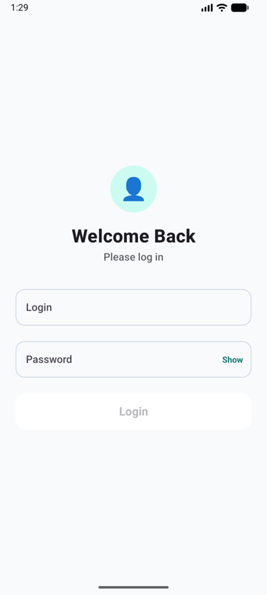

# Android Calculator App

An Android app built with Kotlin and Jetpack Compose for the Mobile Devices Programming course at WSB Merito University. It combines two coursework tasks: a calculator that performs arithmetic on two numbers and reports whether the result is even or odd, and a login screen that protects access to it.

## Screenshots



## Features

**Login**
- Login screen with a Show/Hide toggle for the password
- Error message showing how many attempts remain
- Lockout after 3 failed attempts, with login disabled
- Successful login opens the calculator, which has a Logout button

**Calculator**
- Two number inputs with a numeric keyboard
- Addition, subtraction, multiplication and division
- Input validation and division-by-zero handling
- Result classified as an even number, an odd number or a decimal result
- Animated result card and a Clear button
- Custom Material 3 theme in deep teal and mint, with light and dark mode support

> The login credentials (`admin` / `admin`) are hard-coded as required by the assignment. This is a demo, not real authentication.

## Tech stack

- Kotlin
- Jetpack Compose
- Material 3
- Gradle (Kotlin DSL)

## Getting started

1. Clone the repository:

   ```
   git clone https://github.com/xavmamp/android-calculator-app.git
   ```

2. Open the project in Android Studio.
3. Let Gradle sync, then run the app on an emulator or a physical device.
4. Log in with `admin` / `admin`.

## Author

Xavier Mampouya – [GitHub](https://github.com/xavmamp)
